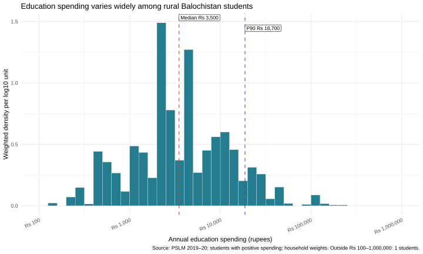
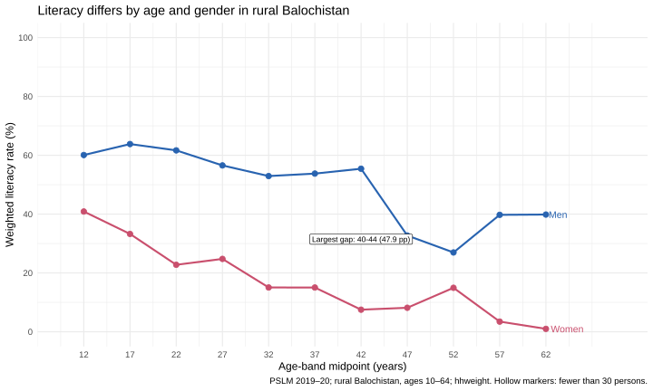
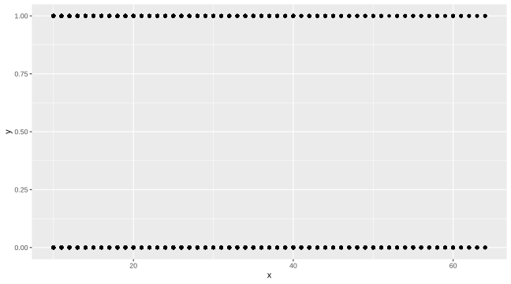
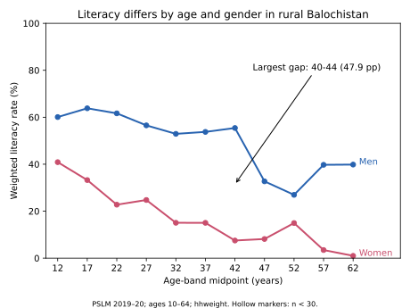

# ECO346 Assignment 1 — Education Spending and Literacy

**Student:** Zainab Ashraf  
**Registration:** FA24-BEDS-078  
**Variant:** 6 — Balochistan Rural

> These tables reproduce the current results saved in the repository's `figures/` CSV files. The repository name uses `FA24-BEDS-078`, so check the official registration spelling before submission.

## Q1 — Data, scripts and reproducibility

The repository uses `data/pslm_person_subset.csv` and `data/pslm_hh_subset.csv`. For Balochistan Rural, the scripts merge survey weight `hhweight` and area variables from household data by `hhid`, then select `prov_code == 4` and `urban_rural == 1`.

**Run in RStudio from the repository root:**

```r
install.packages('ggplot2') # only if not already installed
source('scripts/01_q2.R')
source('scripts/02_q3.R')
source('scripts/03_q4.R')
```

**Run in a terminal from the same folder:**

```bash
py scripts/04_q5_python.py
```

Python requires pandas, numpy, and matplotlib. Graphs and results are written to `figures/`. R's Q3 CSV should be created before the Q5 Python check. Confirm the `default.svg` Git commit predates the Q3 redesign commit, as required by the assignment.

## Q2 — Weighted education spending

The Q2 R analysis keeps person-level observations with `ed_total > 0` and valid positive household weights. Weighted percentiles use the first sorted expenditure value at which cumulative normalized weight reaches the relevant percentile.

| Indicator | RStudio result |
|---|---:|
| Student observations | **1,464** |
| Weighted P10 | **Rs. 600** |
| Weighted median | **Rs. 3,500** |
| Unweighted median | **Rs. 3,000** |
| Weighted P90 | **Rs. 18,700** |
| P90 / weighted median | **5.34** |
| Excluded outside log10 range 2–6 | **1** |



**Interpretation:** The weighted median annual student spending is Rs. 3,500, while the 90th percentile is Rs. 18,700, about 5.34 times as high. This indicates substantial variation among students with positive spending. The histogram uses weighted density per log10 unit, with 0.1-width bins from log10 2 through 6. One observation is excluded from the displayed range, not from the overall percentile calculation.

[Q2 numerical output](figures/q2_results.csv)

## Q3 — Weighted literacy by age and gender

The sample includes persons ages 10–64 with nonmissing literacy and valid survey weights. Sex codes are 1 = Men and 2 = Women. Rates are weighted means multiplied by 100, and `n` values are **unweighted counts**.

| Age band | Men n | Men rate | Women n | Women rate |
|---|---:|---:|---:|---:|
| 10–14 | 663 | 60.08% | 428 | 40.88% |
| 15–19 | 477 | 63.81% | 293 | 33.25% |
| 20–24 | 358 | 61.66% | 307 | 22.77% |
| 25–29 | 355 | 56.54% | 347 | 24.76% |
| 30–34 | 297 | 52.93% | 309 | 15.05% |
| 35–39 | 266 | 53.76% | 252 | 15.04% |
| 40–44 | 227 | 55.42% | 198 | 7.50% |
| 45–49 | 181 | 32.70% | 149 | 8.15% |
| 50–54 | 133 | 26.95% | 111 | 14.95% |
| 55–59 | 95 | 39.75% | 79 | 3.45% |
| 60–64 | 93 | 39.84% | 59 | 0.98% |

**Requested rates:** ages **15–19**: men **63.81%**, women **33.25%** (gap **30.56 percentage points**). Ages **55–59**: men **39.75%**, women **3.45%** (gap **36.30 percentage points**). The **largest gender gap overall** is ages **40–44**, with men **55.42%**, women **7.50%**, a gap of **47.92 percentage points**.



**Interpretation:** Men's weighted literacy rates exceed women's in every displayed age band. The largest gap is at ages 40–44. These patterns are descriptive and cannot establish that age or gender itself causes literacy differences; differences between cohorts and access to schooling may also matter. The plot uses hollow markers for unweighted cells smaller than 30; none of the current displayed cells is below 30.

[Complete R age-band table](figures/q3_band_table_R.csv)

## Q4 — Default graph and redesigned visualization

**Default plot**, produced using exactly `ggplot(data, aes(x, y)) + geom_point()`:



**Redesign:** Q3 weighted literacy chart.


**Three design improvements:** The redesign summarizes overlapping person-level observations into age-band weighted rates, making comparisons easier. Separate lines, distinct colors and labels near their endpoints clarify the male and female series without a legend. An annotation identifies the largest gender gap; clear axes and a data caption add context. The default scatterplot shows raw individual-level variation that the aggregated redesign hides. These changes support comparison, legibility, and visual hierarchy. **The assignment requires the default graph to have been committed before the redesign; inspect Git history to verify that sequence.**

## Q5 — Python replication of R literacy analysis

The Python script reproduces the same household merge, rural filter, age bands, missing-value restrictions, and survey-weighted literacy means as Q3. Comparison of the exported R and Python tables confirms **all 22 sex-by-age-band rates agree to one decimal place**.

| Example | R | Python |
|---|---:|---:|
| Women ages 15–19 | **33.25%** | **33.25%** |
| Men ages 15–19 | 63.81% | 63.81% |
| Women ages 55–59 | 3.45% | 3.45% |



[R output](figures/q3_band_table_R.csv) · [Python output](figures/q5_band_table_python.csv)

**Cross-language setting:** pandas categorical `groupby` behavior may include unused groups depending on the `observed` setting, whereas R factor handling may differ. The scripts use explicit gender and numeric age-band groups and exclude missing literacy in both languages, so rates remain consistent. Setting `observed=True` would make categorical group handling explicit if categoricals were used.

## Q6 — Presentation

The final PowerPoint presentation is uploaded in slides/FA24-BED-078.pptx. It includes the assigned Variant 6 (Balochistan Rural), education expenditure results, literacy graphs, default and redesigned visualizations, interpretations, and a conclusion with Thank You. The presentation contains five slides.

## Submission check

- [x] Q2, Q3 and Q4 R scripts uploaded.
- [x] Q5 Python script uploaded.
- [x] Q2 weighted statistics and Q3 full table saved as CSV.
- [x] Python and R rates agree to one decimal place.
- [x] SVG figure files uploaded.
- [x] Final PowerPoint uploaded in slides/.


